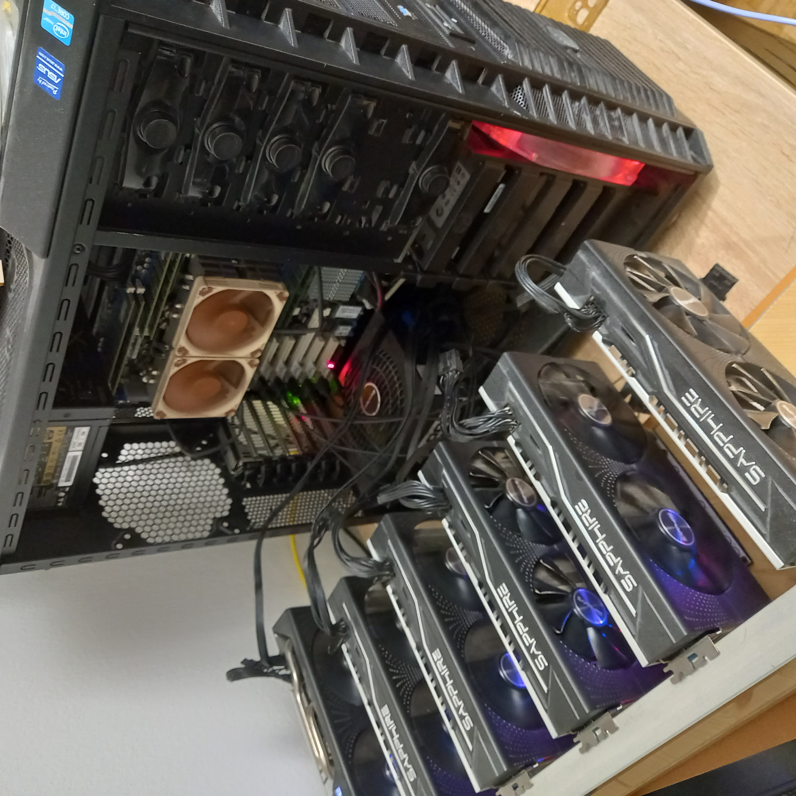
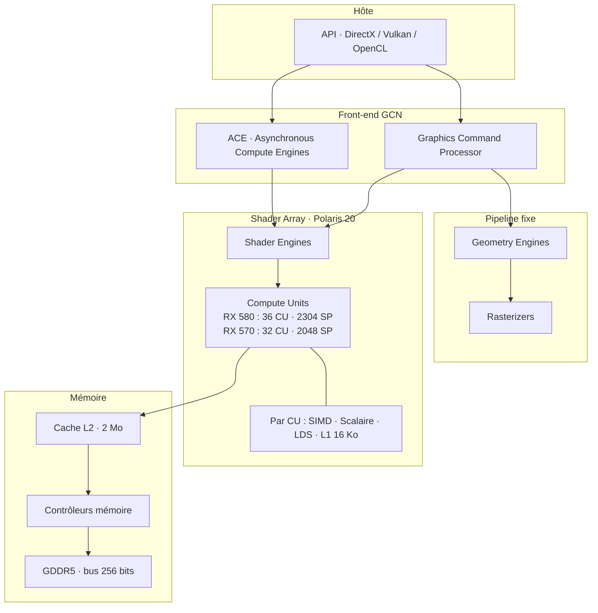

# 6× Polaris — Llama 3.3 70B Q4, split layer, ctx 25.6k (TurboQuant optionnel)

Runbook et scripts pour **Llama 3.3 70B Q4** sur **6 GPU AMD GCN Polaris** (Windows Vulkan), plus un correctif **optionnel** pour le cache KV TurboQuant (wave64).

> **Windows Vulkan only** — RX 570 / RX 580, `--split-mode layer`, contexte **25 600** tokens. Ce dépôt n’est **pas** un fork de llama.cpp : pas de binaire ni de poids GGUF.

**Périmètre :** `llama-server` (API OpenAI-compatible + interface web de chat).

Setup validé : **70B multi-GPU** sur 6× 8 Go (2026-08-31).



### Architecture GCN 4.0 (Polaris 20)



GCN Polaris = wavefront **64** (pertinent pour les patchs FA/MMQ et TurboQuant).

## Ce dépôt

```powershell
git clone https://github.com/gaigher/Polaris-multi-GPU-llama.git
cd Polaris-multi-GPU-llama
```

Les commandes ci-dessous s’exécutent **depuis la racine de ce clone**.

## Validé (2026-08-31)

| Plateforme     | Test                                         | Résultat |
| -------------- | -------------------------------------------- | -------- |
| **6× Polaris** | Llama 3.3 70B Q4, split layer, **ctx 25.6k** | **OK**   |

Chat API validé (`/v1/chat/completions`).

**Débit indicatif** (2026-11-01, Q4_K_S, `-np 1`) :
- ctx **8192**, KV `q8_0`/`q8_0` : prompt **~15,5 tok/s** · gen **~1,8 tok/s** (réf. débit smoke)
- ctx **25600**, KV `q8_0`/`turbo3` : charge OK ; smoke court OK (gen **~1,5 tok/s**, ~40 tok prompt) ; prompt plus long → **`ErrorDeviceLost`** pilote (fragile)

Sans `-np 1` / sans TQ à 25.6k : OOM KV fréquent sur Vulkan0 (poids ~6,7 Go).

**Matrice 4 builds GCN** (2026-11-02, Q4_K_S, ctx 8192, KV `q8_0`/`q8_0`, prompt_n≈1617, gen 128, 5 paires alternées) :

| Build | PP moy | TG moy | ΔPP vs ref |
| ----- | ------ | ------ | ---------- |
| ref | 13,60 | 1,183 | — |
| fa (LDS) | 13,55 | 1,189 | −0,4 % |
| **mmq** | **15,51** | 1,200 | **+14,0 %** |
| both (FA+MMQ) | 15,33 | 1,160 | +12,7 % |

**Verdict :** retenir **`builds/mmq`** (`gcn-mmq-proprietary`). FA seul neutre/négatif sur Llama 70B ; A+B n’ajoute rien. VRAM inchangée.  
Détail : `bench_results/polaris-llama70-20261102-195848.summary.md` (premier banc MMQ seul : `…184312.summary.md`).

Pour reproduire : `scripts/benchmark_polaris.ps1` (warm-up, ≥5 runs, CSV, session unique).

## Prochaines optimisations (PP / TG / VRAM)

Au-delà de TurboQuant et MoE : viser **les trois axes à la fois** (préremplissage, génération, VRAM). Une optimisation peut en améliorer un et dégrader les deux autres.

| Priorité | Expérience | Statut |
| -------- | ---------- | ------ |
| 1 | Patch Vulkan GCN (4 builds) | **Fait** — MMQ retenu |
| 2 | `-b` / `-ub` sur binaire MMQ | **Fait** — retenir `-b 1024 -ub 256` (PP +1,7 % vs 2048:512) ; détail `bench_results/polaris-llama70-20261112-115638.summary.md` |
| 3 | `--tensor-split` (proportions layer, pas TP) | à faire |
| 4 | Ordre PCIe / NUMA des GPU | à faire |
| 5 | NUMA / affinité CPU (GPT-OSS) | à faire |
| 6 | Quants GGUF | à faire |
| 7 | Décodage spéculatif | à faire |
| 8 | Fréquences mémoire GPU | à faire |

Roadmap : **[Plan Optimiser PP-TG-VRAM.md](Plan%20Optimiser%20PP-TG-VRAM.md)** · source externe : [doteyeso-ops/rx580-vulkan-fa-lds](https://github.com/doteyeso-ops/rx580-vulkan-fa-lds)

```powershell
# Binaire MMQ retenu
$mmq = ".\builds\mmq\llama-server.exe"

# Lancement retenu (MMQ + batch)
.\scripts\lancer_70b_6gpu.ps1 -ServeurLlama $mmq -Batch 1024 -UBatch 256

# Reproduire le balayage batch
.\scripts\benchmark_polaris.ps1 -ServeurLlama $mmq `
  -BatchVariants "1024:256,2048:256,2048:512,4096:512,4096:1024" `
  -CtxList 8192 -PromptTokens 2048 -Runs 5
```

`lancer_70b_6gpu.ps1` expose aussi `-Batch`, `-UBatch`, `-Threads`, `-ThreadsBatch`, `-TensorSplit`, `-Numa`.

## Expérimental : GPT-OSS 120B

Scénario **MoE** (placement `-ot` partiel GPU + experts CPU) sur les mêmes 6× Polaris — **non validé** comme le 70B.

- Réf. expérimentale : **S-23** + `-t 8` + **`--moe-cache off`** (Polaris 8 Go : `512` alloue après patch mais ~9× plus lent)
- Runbook : [docs/GPT-OSS_120B.md](GPT-OSS_120B.md)
- Optimisations MoE + PR cache Vulkan : [docs/Plan Optimiser MoE.md](Plan%20Optimiser%20MoE.md) → upstream [PR #401](https://github.com/TheTom/llama-cpp-turboquant/pull/401)
- Placement incrémental : `scripts/placer_experts_incremental.ps1` (**expérimental**, sans `-MoeCache` en prod)

## Prérequis

- 6 cartes Polaris 8 Go (testé : 1× RX 570 + 5× RX 580)
- Pilotes AMD récents, Vulkan fonctionnel sous Windows
- Un GGUF **local** Llama 3.3 70B Instruct Q4 (ex. `Q4_K_M`, ~40 Go). Non fourni ici ; exemple : [bartowski/Llama-3.3-70B-Instruct-GGUF](https://huggingface.co/bartowski/Llama-3.3-70B-Instruct-GGUF) (`Llama-3.3-70B-Instruct-Q4_K_M.gguf`). Respecter la [licence Llama 3.3](https://www.llama.com/llama3_3/license/)
- Un `llama-server` Vulkan (voir ci-dessous)

## Obtenir `llama-server`

Sans TurboQuant, n’importe quel `llama-server` Vulkan Windows suffit, par exemple :

- build officiel [ggml-org/llama.cpp](https://github.com/ggml-org/llama.cpp/releases) (zip Vulkan), ou
- build local [TheTom/llama-cpp-turboquant](https://github.com/TheTom/llama-cpp-turboquant) (nécessaire seulement pour `turbo3`).

Pointez ensuite la variable d’environnement vers le `.exe` réel (adaptez le chemin) :

```powershell
$env:SERVEUR_LLAMA = "C:\chemin\vers\llama-server.exe"
& $env:SERVEUR_LLAMA --list-devices
```

Le script `lancer_70b_6gpu.ps1` utilise `$env:SERVEUR_LLAMA` (sinon il cherche `%USERPROFILE%\Documents\llama-cpp-turboquant\build\bin\llama-server.exe`).

## Lancer le 70B (6 GPU)

### 1. Vérifier les périphériques Vulkan

Attendu (exemple) :

```
Vulkan0: Radeon RX 570 Series (8192 MiB, ...)
Vulkan1: Radeon RX 580 Series (8192 MiB, ...)
...
Vulkan5: Radeon RX 580 Series (8192 MiB, ...)
```

Notez les identifiants `Vulkan0` … `Vulkan5`. L’ordre peut varier selon les slots PCIe — adaptez `--device` si besoin.

### 2. Lancer le serveur (config validée)

Toujours depuis la racine de ce clone :

```powershell
$env:MODELE_LLAMA = "C:\chemin\vers\Llama-3.3-70B-Instruct-Q4_K_M.gguf"
# $env:SERVEUR_LLAMA déjà défini à l’étape précédente

.\scripts\lancer_70b_6gpu.ps1
```

Ou en une ligne :

```powershell
& $env:SERVEUR_LLAMA `
  -m $env:MODELE_LLAMA `
  --host 127.0.0.1 --port 8080 `
  -c 25600 -ngl 99 -fa on -np 1 `
  --split-mode layer `
  --device Vulkan0,Vulkan1,Vulkan2,Vulkan3,Vulkan4,Vulkan5 `
  --fit off `
  -v --log-timestamps
```

#### Paramètres clés

| Option | Valeur | Rôle |
|--------|--------|------|
| `-c 25600` | ctx 25.6k | Fenêtre de contexte validée |
| `-np 1` | 1 slot | Évite `n_seq_max=4` (KV ×4) qui OOM sur Polaris 8 Go |
| `--split-mode layer` | layer | Répartit les 80 couches + KV sur les 6 GPU |
| `--device Vulkan0,…,Vulkan5` | 6 GPU | Tous les Polaris visibles par Vulkan |
| `--fit off` | pas d’ajustement auto | Évite que llama.cpp réduise le ctx silencieusement |
| `-ngl 99` | toutes les couches GPU | Indispensable pour le 70B |
| `-b` / `-ub` | 2048 / 512 (défaut script) | Batch logique / physique — impact PP et VRAM temporaire |
| `--tensor-split` | optionnel | Proportions de couches entre GPU (toujours en mode `layer`) |

### 3. Chat HTML et vérification

Une fois le serveur chargé, ouvrez dans le navigateur :

**[http://127.0.0.1:8080/](http://127.0.0.1:8080/)**

C’est l’interface web fournie par `llama-server` : conversation, paramètres, historique. Aucune UI supplémentaire à installer.

Test API rapide (sans navigateur) :

```powershell
Invoke-RestMethod -Uri "http://127.0.0.1:8080/health" -UseBasicParsing
$corps = '{"messages":[{"role":"user","content":"Bonjour"}],"max_tokens":64}'
Invoke-RestMethod -Uri "http://127.0.0.1:8080/v1/chat/completions" `
  -Method Post -ContentType "application/json" -Body $corps
```

Arrêt : **Ctrl+C** dans le terminal qui a lancé `llama-server`.

### 4. Mémoire / contexte

Le poids Q4 du 70B (~40 Go) est réparti sur les 6× 8 Go ; le KV s’ajoute par GPU selon les couches hébergées. Vulkan0 est souvent le plus juste (~6,7 Go de poids). Si OOM au chargement : **`-np 1`**, TurboQuant, réduire `-c`, ou vérifier qu’aucune autre app utilise la VRAM.

## Optimisation optionnelle : TurboQuant

Pour gagner de la VRAM sur le cache KV (`turbo3`), un patch Polaris (wave64) et un build TheTom sont possibles. Ce n’est **pas** requis pour le 70B multi-GPU ci-dessus.

Sur Polaris, sans ce patch, `turbo3` provoque un `GGML_ASSERT` (subgroup 32 vs wave64).

- Patch, build et détails : [docs/TurboQuant_POLARIS.md](TurboQuant_POLARIS.md)
- Lancement avec TurboQuant : `.\scripts\lancer_70b_6gpu.ps1 -TurboQuant`
- Contribution upstream (subgroup) : [Plan Optimiser MoE.md — § C.4](Plan%20Optimiser%20MoE.md#c4-pr-voisine--subgroup-set_rows-wave64)

Exemple (après patch + build TheTom) :

```powershell
& $env:SERVEUR_LLAMA `
  -m $env:MODELE_LLAMA `
  --host 127.0.0.1 --port 8080 `
  -c 25600 -ngl 99 -fa on -np 1 `
  --split-mode layer `
  --device Vulkan0,Vulkan1,Vulkan2,Vulkan3,Vulkan4,Vulkan5 `
  --cache-type-k q8_0 --cache-type-v turbo3 `
  --fit off `
  -v --log-timestamps
```

Mesure indicative KV (K `q8_0` / V `turbo3`, ctx 25.6k, 1 seq) :

```
llama_kv_cache: size = 2906.25 MiB ( 25600 cells,  80 layers,  1/1 seqs), K (q8_0): 2125.00 MiB, V (turbo3):  781.25 MiB
```

## Licence

MIT — voir [LICENSE](LICENSE) (texte anglais). Compatible avec llama.cpp / TheTom (MIT).

Les poids Llama 3.3 et GPT-OSS restent sous leurs licences respectives ; ils ne font pas partie de ce dépôt.
